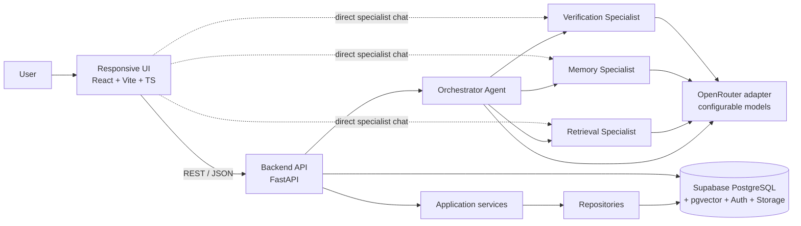
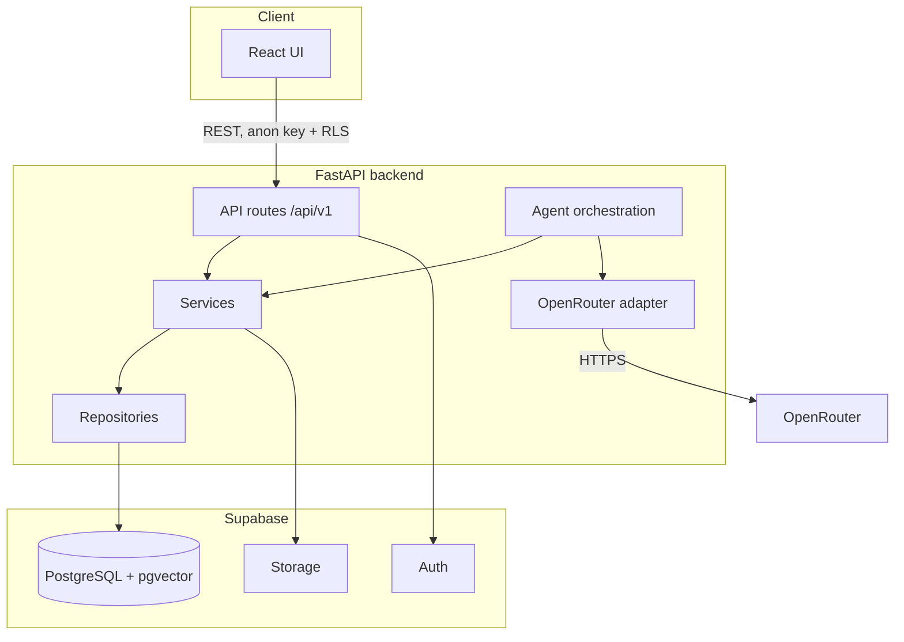

# MNEMOS — Architecture

> Status: **Phase 0 — approved foundation.** This document records the
> initial approved architecture. Items marked **[Confirmed]** are decided;
> items marked **[Proposed]** are planned but not yet validated by
> implementation. No product features exist yet.

## 1. System context

MNEMOS is a provenance-aware multi-agent personal knowledge management and
memory system. A user submits personal knowledge (documents, notes), asks
questions about it, inspects supporting evidence, reviews revisions,
identifies conflicts, corrects information, and receives explicit
insufficient-evidence responses when evidence is lacking.



## 2. Major components and responsibilities

| Component | Responsibility | Status |
|---|---|---|
| Responsive UI (React/Vite/TS) | Application shell, conversation interfaces (both modes), agent directory, knowledge workspace structure, settings | **[Implemented Phase 1]** — shell and structure; no AI features |
| Backend API (FastAPI) | REST endpoints, auth enforcement, validation, error mapping, repository layering | **[Implemented Phase 1]** — health/readiness, `/me`, `/me/preferences`, `/workspaces` |
| Orchestrator agent | Chooses the plan, records the trace, never writes answer text | **[Implemented Phase 3D]** — ADR-0013 |
| Retrieval specialist | Hybrid lexical + semantic search, fused, provenance-bound | **[Implemented Phase 3A]** |
| Analyst agent | Writes an answer using only the evidence it was given; abstains instead of guessing | **[Implemented Phase 3B]** |
| Verification specialist | Checks claims against cited evidence; keeps unverified distinct from unsupported | **[Implemented Phase 3C]** — ADR-0012 |
| Memory specialist | Corrections as revisions, conflict detection, supersession | **[Implemented Phase 3C]** — propose/review/apply; no overwrite path |
| Shared knowledge & provenance layer | Canonical storage of knowledge, sources, revisions, evidence links | **[Implemented Phases 2A–2C, 3A–3D]** — RLS forced on every table |
| Foundational data layer | Profiles, workspaces, membership, preferences, private storage bucket | **[Implemented Phase 1]** — migrated with RLS |
| OpenRouter adapter | Centralized model access, normalization, retries, usage logging | **[Implemented]** — chat and embeddings adapters; **never called live** in this repository |
| Supabase platform | PostgreSQL, Auth, Storage, RLS, migrations, pgvector | **[Implemented Phase 1]** locally; remote project pending credentials |

## 3. Communication boundaries

- **UI → API:** REST/JSON over HTTPS. The UI never queries the database
  directly and never holds privileged keys. In development, Vite proxies
  `/api` to the backend so the browser uses relative URLs only.
- **API → services → repositories → Supabase:** controlled data access.
  Agents never execute arbitrary SQL.
- **Agents ↔ OpenRouter:** single adapter; structured request/response
  normalization; capability checks per model.
- **Agents ↔ knowledge layer:** only via controlled service interfaces
  that enforce ownership, provenance, and evidence validation.



## 4. Data-flow overview

1. User submits knowledge → API validates → service stores original in
   private Storage bucket → text extracted → provenance recorded → text
   chunked deterministically → chunks embedded and stored as vectors, each
   with its recorded configuration and embedding model. A source is only
   `ready` once both chunking and embedding succeeded.
2. User asks a question → orchestrator delegates to retrieval specialist →
   vector + keyword search over the user's own knowledge → verification
   specialist checks claims against evidence → answer returned with
   evidence references, or an explicit insufficient-evidence response.
3. Revisions and corrections are versioned; conflicts are surfaced, never
   silently overwritten.

## 5. Database integration

- Supabase PostgreSQL is the sole database. No separate PostgreSQL server.
- Versioned migrations under `supabase/migrations/`; RLS on every
  user-owned table; ownership via `owner_id` referencing `auth.users`.
- pgvector for semantic retrieval **[Proposed]** — extension availability
  and embedding-dimension compatibility must be validated in a later phase.
- See `docs/supabase/README.md`, `rls-strategy.md`, `storage-strategy.md`.

### Phase 1 schema (implemented)

```
auth.users
   ├── public.profiles            (1:1, cascade)
   ├── public.user_preferences    (1:1, cascade)
   └── public.workspaces          (1:N owner_id, cascade)
            └── public.workspace_members  (N:M via auth.users, composite PK)
```

RLS is enabled **and forced** on all four tables. Helper functions
(`is_workspace_member`, `has_workspace_role`) are `SECURITY DEFINER` with a
pinned `search_path` to avoid recursive policy evaluation. Anonymous users
hold no table grants. Full reference: `docs/supabase/schema.md`;
access layering: `docs/supabase/access-architecture.md` (ADR-0008).

### Request path (implemented)

```
React component
  → lib/api client (typed, bearer token)
    → FastAPI route (validation, identity resolution)
      → service (authorization policy)
        → repository interface (named operations only)
          → user-scoped Supabase client
            → PostgreSQL + RLS (final authority)
```

No generic SQL entry point exists anywhere, so future agents cannot execute
arbitrary queries (ADR-0008).

## 6. AI integration

- OpenRouter is the model-access and routing layer (not a model).
- Centralized adapter with environment-based keys, per-responsibility
  model IDs, timeouts, bounded retries, error classification, rate-limit
  handling, usage/cost logging, and model ID in every execution record.
- Structured-output validation and tool-calling capability checks per
  model. No hardcoded models. No paid calls without approval.
- See `docs/openrouter/README.md`.
- **Embeddings are a separate provider concern** (ADR-0010): they use an
  `/embeddings` endpoint with an OpenAI-compatible body, never a
  chat-completions path. The adapter refuses a chat URL at construction,
  validates every returned vector against the configured dimension, retries
  only 429/5xx/timeouts, and records `prompt_tokens` per request. Model,
  dimension, batch size, timeout and retries are environment settings.
- Chunking is deterministic (`paragraph-window`, 900 target / 150 overlap /
  4000 hard maximum). The configuration is recorded on every chunk, and the
  indexer refuses to mix chunk shapes within one version. See
  `docs/CHUNKING_AND_INDEXING.md`.

## 7. Security boundaries

- Supabase Auth is the identity provider. Authorization enforced
  server-side and via RLS — never frontend-only.
- Service-role key server-side only; publishable/anon key only with RLS.
- Private Storage buckets, user-scoped paths, signed URLs.
- Input validation, file-type/size checks, prompt-injection defenses,
  sanitized errors, structured logging without secrets.
- See [RULES.md](RULES.md) §8 and `docs/supabase/rls-strategy.md`.

## 8. Agent contracts

An agent in MNEMOS is a **role with a declared capability set**, not an
autonomous loop. This is a deliberate architectural choice with its own record
(ADR-0013): an agent that chose its own steps would produce a trace describing
what it decided to report rather than what it did, and would make Phase 4A's
comparisons non-reproducible.

| Role | Capabilities | Model role | Trace contribution |
|---|---|---|---|
| `orchestrator` | `synthesise` | none | Opens the run with the plan, closes it with what happened |
| `researcher` | `retrieve` | none | Passages considered and cited |
| `analyst` | `generate` | `generation` | Answer status, claims, citations |
| `critic` | `verify`, `critique` | `verification` | Supported / unsupported / unverified / contradicted counts |

Isolation is structural, not advisory. Each agent is constructed with only the
services its capabilities allow, so the analyst has no verifier to call and the
critic has no generator to amend an answer with. `require_capability()` guards
the seam in case wiring drifts. No agent has SQL, filesystem or arbitrary network
access, and no configuration flag grants one.

Trace rules:

- a step is written **after** the work it describes, by the code that did it;
- the plan is written **before** execution, so a deviation stays visible;
- `skipped` is distinct from `succeeded` and carries its reason — an answer whose
  critic was skipped is returned `degraded: true`, because an unchecked answer
  must not look like a checked one;
- a failed analyst produces no answer row;
- traces hold results and metadata, never document text or raw prompts;
- `authenticated` may SELECT traces and has no INSERT: a client-authored trace is
  not evidence.

Degradation is reported, never hidden. The response carries `degraded`, the
per-agent statuses, and the reason the plan omitted a specialist.

## 8a. Retrieval and grounding

`docs/RETRIEVAL_AND_GROUNDING.md` describes the path from question to cited
answer end to end: hybrid search, fusion, the abstention rule, citation binding
and verification. The invariants it states — no evidence means no model call, an
unknown citation invalidates the answer, `unverified ≠ unsupported` — are the
ones the tests defend.

## 9. Architectural assumptions

- Single-user personal knowledge system with strict per-user isolation.
- Supabase free/pro tiers provide required Postgres, Auth, Storage, and
  pgvector capabilities (to be validated).
- OpenRouter offers at least one model per agent responsibility with
  adequate capability (to be validated per model).
- Personal knowledge volume is modest; no need for separate search
  infrastructure in early phases.

## 10. Known risks

- pgvector extension or dimension limits may constrain embedding choices.
- Model capability variance across OpenRouter models (structured output,
  tool calling) requires per-model validation.
- Prompt injection via submitted documents is an ongoing threat.
- Supabase platform limits (storage, egress, RLS performance) must be
  monitored as usage grows.
- Scope creep from research objectives must be controlled via
  [REQUIREMENTS.md](REQUIREMENTS.md) traceability.
