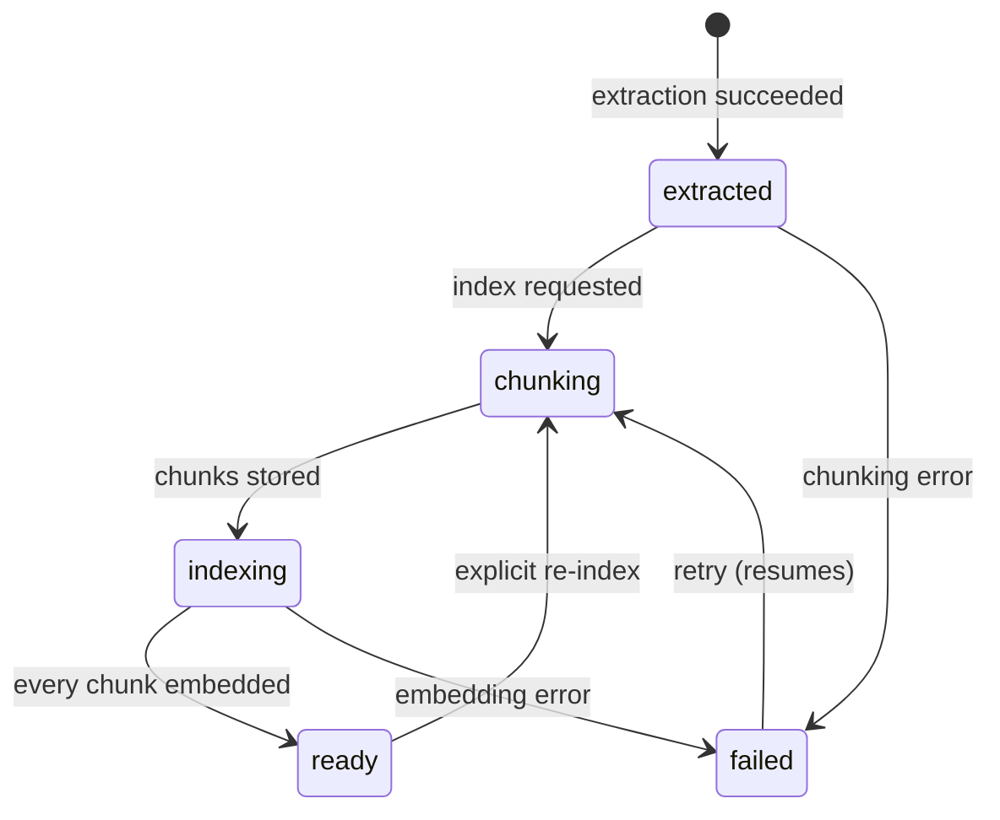

# Chunking and Indexing

How extracted text becomes retrievable, citable passages and vectors.
Implemented in Phase 2C.

## 1. Why this strategy

Three candidate strategies were considered:

| Strategy | Problem |
|---|---|
| Fixed character window | cuts sentences in half, so a citation shows a fragment and claim verification compares against truncated evidence |
| Pure paragraph split | produces very large chunks for unbroken prose (a 9000-character single paragraph becomes one unit), diluting the embedding across several topics and making citations imprecise |
| Semantic/LLM boundary detection | non-deterministic, costs a model call per document, and cannot be reproduced from a recorded configuration |

**Chosen: paragraph-window with sentence-boundary closure and sentence-aware
overlap.** Deterministic, no model involvement, and it guarantees that a chunk
ends on a sentence boundary whenever one is available within the window.

Algorithm (`app/services/chunking.py`):

1. Take the window `[start, start + target)`.
2. Move the end back to the last sentence terminator inside the window.
3. If there is none, widen to the hard maximum, then to the last space, then
   hard-split (so an unpunctuated blob is still cut, and a word is never cut
   when whitespace exists).
4. The next window starts `overlap` characters back, moved forward to the first
   sentence terminator so the next chunk opens on a readable boundary.

## 2. Parameters and the evidence for them

Measured on a 8 879-character prose block with no blank lines (60 sentences),
and a 29 038-character document with paragraphs:

| target | overlap | chunks | min / median / max chars | index overhead |
|---|---|---|---|---|
| 600 | 100 | 20 | 395 / 544 / 592 | 1.21× |
| **900** | **150** | **12** | **739 / 888 / 888** | **1.18×** |
| 1200 | 200 | 9 | 591 / 1184 / 1184 | 1.13× |

Paragraph-structured text at the default: 40 chunks, 726 / 728 / 728 chars,
1.00× overhead (overlap only applies when a window is closed early).

`target_chars = 900` is chosen because it holds a complete argument without
spanning several topics, and the overlap cost (1.18× index size) is the
cheapest of the three without producing fragments below ~400 characters.

`overlap_chars = 150` is roughly one sentence: enough to rescue a sentence that
straddles a boundary, and small enough that the index does not grow materially.

`HARD_MAX_CHARS = 4000` bounds the worst case. It is not a target; it exists so
a pathological input (a 20 000-character unpunctuated blob) cannot produce a
single unusable chunk.

**Changing any of these requires bumping `CHUNKING_VERSION`.** The configuration
is stored in each chunk's `metadata.chunking_config` *and* in the method/version
columns, and the indexer refuses to mix chunk shapes in one version rather than
silently reinterpreting them.

## 3. Measured behaviour (from the tests)

`tests/unit/test_chunking.py` (20 tests) asserts:

- every chunk's `text[start:end]` equals its `content` exactly, for targets
  100/300/900/2000;
- chunk indices are contiguous from 0;
- chunks end on `.`/`!`/`?` wherever a sentence end exists in the window;
- neighbouring chunks share text, and the shared length never exceeds
  `overlap_chars`;
- page numbers come from the page map and are absent when there is no map;
- `content_hash` equals sha256 of the content;
- chunking the same text twice produces identical indices, content and hashes;
- a different configuration produces a different chunk count;
- a 20 000-character unpunctuated blob never exceeds the hard maximum.

`test_chunks_and_embeddings_end_to_end` in `tests/integration/` additionally
proves against real PostgreSQL that **every** stored chunk can be reconstructed
from its own offsets (`0` mismatches over all chunks).

## 4. Embedding provider

See **ADR-0010**. Summary:

- the endpoint is `POST …/embeddings` (OpenAI wire format); any base URL that
  looks like a chat/completions path is refused at construction;
- model, dimension, batch size, timeout and retries are environment settings;
- every returned vector is checked against `EMBEDDING_DIMENSION` before storage;
- retries cover 429/5xx/timeouts only; other 4xx fail immediately;
- `prompt_tokens` is captured per request and logged, never estimated for cost.

**No live embedding call has been made** — there is no API key in this
environment. Request/response handling is tested against recorded
OpenAI-wire-format fixtures (22 tests).

## 5. Vector storage

```sql
chunk_embeddings (
  chunk_id uuid primary key references chunks(id) on delete cascade,
  workspace_id uuid not null,
  document_version_id uuid not null,
  embedding_model text not null,
  embedding_dim integer not null,
  embedding vector(N) not null,
  created_at timestamptz not null default now()
)
```

- **Dimension** `N` comes from `app.embedding_dimension` at migration time,
  validated to `1..16000`. Not hardcoded in application logic.
- **Index** HNSW, `vector_cosine_ops`, `m=16`, `ef_construction=64`. Chosen over
  IVFFlat because it needs no training pass and gives better recall on a small,
  growing corpus; an insertion-time cost is acceptable here.
- **Metric** cosine. Embedding models are trained for cosine similarity and the
  adapter does not normalise vectors, so cosine is the correct comparison.
- **Isolation** `workspace_id` is stored and `match_chunks()` filters on it,
  *and* RLS applies because the function is `SECURITY INVOKER`. Verified: a
  non-member gets 0 rows; a member gets 0 rows for a foreign workspace.
- **Metadata filters** (source, version, information status) are applied by the
  retrieval layer in Phase 3A on the joined chunk/provenance rows rather than in
  the vector query, so filtering cannot silently drop the RLS scope.

## 6. Lifecycle



- `ready` is set **only** when chunking and embedding both succeed, and is
  re-read from the database before being reported.
- A source with no embedding provider configured stays `extracted` with
  `embedding_not_configured`; the UI says "not searchable yet" rather than
  failing the upload.
- Retries resume: existing chunks matching the configuration are reused, and
  chunks that already have vectors are skipped. Neither step can duplicate.

## 7. Re-indexing

`POST /knowledge/sources/{id}/reindex` deletes that version's embeddings and
chunks, then rebuilds. It is explicit because it destroys derived data.

- The original file, its version row and its extracted text are untouched.
- Only the named version is affected; older versions keep their chunks.
- `provenance_records` is *not* recreated — chunk rows are new, so new
  provenance rows are created for them, while the old ones cascade away with
  the old chunks. An evidence reference that pointed at an old chunk therefore
  resolves to "not found" after a rebuild, which is honest: that exact chunk no
  longer exists. Phase 3C must treat an unresolvable reference as unsupported.

## 8. Honest limits

- No embedding request has been made; the dimension of any specific model is
  unconfirmed. The code fails loudly on a mismatch rather than adapting.
- No ANN tuning has been done: `m` and `ef_construction` are defaults chosen by
  reasoning, not measured on a real corpus. Retrieval quality measurement is a
  Phase 3A task.
- pgvector availability on the target Supabase project is unverified; the
  migration raises `feature_not_supported` rather than skipping silently.
- Chunking is character-based, so a language without spaces (or with very long
  sentences) will produce chunks nearer the hard maximum.
