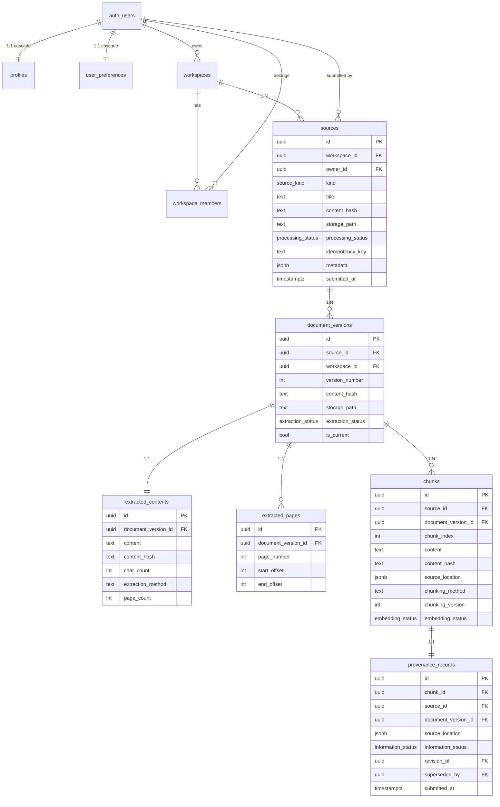

# Database Schema

Authoritative description of the MNEMOS database. Documentation that
disagrees with `supabase/migrations/` is a bug.

**Verified against:** PostgreSQL 16 (local pgserver harness) — Phase 1B
(62 checks) plus Phase 2A (109 checks). **Not verified:** a live Supabase
project, GoTrue, PostgREST and the Storage API.

Migrations, applied in filename order:

| Migration | Contents |
|---|---|
| `20260101000000_initial_schema.sql` | profiles, workspaces, workspace_members, user_preferences; triggers; signup bootstrap |
| `20260101000100_rls_policies.sql` | RLS enable/force, helper functions, grants |
| `20260101000200_storage_sources_bucket.sql` | private `sources` bucket and object policies |
| `20260102000000_knowledge_schema.sql` | sources, document_versions, extracted_contents, extracted_pages, chunks, provenance_records |
| `20260102000100_knowledge_rls.sql` | RLS for the knowledge tables, version immutability trigger |
| `20260102000200_chunk_embeddings.sql` | `chunk_embeddings`, pgvector index, vector search function |
| `20260103000000_retrieval.sql` | `hybrid_search_chunks(...)`, `RETRIEVAL_*`-driven fusion |
| `20260103000100_conversations.sql` | conversations, messages, answers, claims, claim_citations, execution_records |
| `20260103000200_verification_memory.sql` | claim_verifications, knowledge_corrections, knowledge_conflicts, `apply_knowledge_correction(uuid, uuid)`, `provenance_text_for_workspace(uuid, uuid[])`, `current_provenance` view |
| `20260103000300_agents.sql` | orchestration_runs, agent_runs, agent_steps, `orchestration_trace(uuid)`, scope trigger |

## Entity relationship

## Phase 1B tables

### public.profiles

| Column | Type | Constraints |
|---|---|---|
| `id` | `uuid` | PK, FK → `auth.users.id` ON DELETE CASCADE |
| `email` | `text` | nullable |
| `display_name` | `text` | nullable, 1–80 chars when present |
| `avatar_url` | `text` | nullable |
| `created_at` | `timestamptz` | NOT NULL DEFAULT `now()` |
| `updated_at` | `timestamptz` | NOT NULL DEFAULT `now()`, trigger-maintained |

### public.workspaces

| Column | Type | Constraints |
|---|---|---|
| `id` | `uuid` | PK DEFAULT `gen_random_uuid()` |
| `owner_id` | `uuid` | NOT NULL FK → `auth.users.id` CASCADE |
| `name` | `text` | NOT NULL, 1–120 chars |
| `slug` | `text` | NOT NULL, `^[a-z0-9]([a-z0-9-]{1,48}[a-z0-9])$` |
| `description` | `text` | nullable, ≤ 2000 chars |
| `created_at` / `updated_at` | `timestamptz` | NOT NULL |

`UNIQUE (owner_id, slug)`; indexes on `owner_id` and `(owner_id, created_at desc)`.

### public.workspace_members

PK `(workspace_id, user_id)`; `role` is the `workspace_role` enum
(`owner`/`editor`/`viewer`). The workspace insert trigger adds the owner row.

### public.user_preferences

`user_id` PK FK → `auth.users`; `theme` in (`system`,`light`,`dark`); `locale`
2–10 chars.

## Phase 2A tables

### public.sources

One row per submitted item. It is a *container*: content lives in
`document_versions`.

| Column | Type | Constraints |
|---|---|---|
| `id` | `uuid` | PK DEFAULT `gen_random_uuid()` |
| `workspace_id` | `uuid` | NOT NULL FK → `workspaces` CASCADE |
| `owner_id` | `uuid` | NOT NULL FK → `auth.users` CASCADE |
| `kind` | `source_kind` | NOT NULL (`document`, `note`) |
| `title` | `text` | NOT NULL, 1–300 chars |
| `original_filename` | `text` | ≤ 255 chars; **NULL for notes**, required for documents |
| `mime_type` | `text` | NOT NULL |
| `size_bytes` | `bigint` | NOT NULL, 0 … 52 428 800 (50 MiB, matches the bucket) |
| `content_hash` | `text` | NOT NULL, `^[0-9a-f]{64}$` |
| `storage_bucket` | `text` | NOT NULL DEFAULT `'sources'` |
| `storage_path` | `text` | NOT NULL, 1–1024 chars, `<user_id>/<...>` |
| `processing_status` | `processing_status` | NOT NULL DEFAULT `pending` |
| `processing_error_code` | `text` | ≤ 64 chars |
| `processing_error_detail` | `text` | ≤ 500 chars, sanitized |
| `processing_attempts` | `integer` | NOT NULL DEFAULT 0 |
| `idempotency_key` | `text` | 8–128 chars |
| `metadata` | `jsonb` | NOT NULL DEFAULT `{}` |
| `submitted_at` | `timestamptz` | NOT NULL DEFAULT `now()` |
| `created_at` / `updated_at` | `timestamptz` | NOT NULL, trigger-maintained |

Constraints beyond the column list:

- `sources_id_workspace_unique UNIQUE (id, workspace_id)` — exists so child
  tables can enforce *same workspace* with a composite foreign key.
- `sources_kind_filename_consistent` — a note cannot carry a filename.
- `sources_idempotency_unique_idx UNIQUE (workspace_id, idempotency_key)
  WHERE idempotency_key IS NOT NULL` — retry safety.

Indexes: `(workspace_id, created_at desc)`, `(owner_id)`, `(processing_status)`.

### public.document_versions

Every submission. **Never updated in place**: a trigger rejects any change to
`content_hash`, `size_bytes`, `storage_path`, `storage_bucket`,
`version_number` or `source_id`, and refuses `is_current` moving `false → true`.

| Column | Type | Constraints |
|---|---|---|
| `id` | `uuid` | PK |
| `workspace_id` | `uuid` | NOT NULL |
| `source_id` | `uuid` | NOT NULL |
| `version_number` | `integer` | NOT NULL ≥ 1, assigned by trigger |
| `content_hash` | `text` | NOT NULL sha256 |
| `size_bytes` | `bigint` | NOT NULL |
| `mime_type` | `text` | NOT NULL |
| `storage_bucket` / `storage_path` | `text` | NOT NULL |
| `extraction_status` | `extraction_status` | NOT NULL DEFAULT `pending` |
| `extraction_method` | `text` | e.g. `plain-text`, `pdf`, `markdown` |
| `extraction_error_code` | `text` | ≤ 64 chars |
| `extraction_error_detail` | `text` | ≤ 500 chars |
| `extracted_at` | `timestamptz` | set when extraction succeeds |
| `indexing_config` | `jsonb` | chunking + embedding configuration used |
| `is_current` | `boolean` | NOT NULL DEFAULT true |
| `idempotency_key` | `text` | 8–128 chars |
| `submitted_by` | `uuid` | FK → `auth.users` ON DELETE SET NULL |
| `submitted_at` / `created_at` / `updated_at` | `timestamptz` | NOT NULL |

- `UNIQUE (source_id, version_number)`
- `document_versions_one_current_idx UNIQUE (source_id) WHERE is_current` —
  at most one current version per source.
- `document_versions_source_workspace_fk (source_id, workspace_id) →
  sources (id, workspace_id)` ON DELETE CASCADE.

### public.extracted_contents

Derived text, kept strictly separate from the original bytes.

| Column | Type | Constraints |
|---|---|---|
| `id` | `uuid` | PK |
| `workspace_id` | `uuid` | NOT NULL |
| `document_version_id` | `uuid` | NOT NULL, **UNIQUE** — one extraction per version |
| `content` | `text` | NOT NULL |
| `content_hash` | `text` | NOT NULL sha256 |
| `char_count` | `integer` | NOT NULL, `= char_length(content)` (checked) |
| `extraction_method` | `text` | NOT NULL |
| `page_count` | `integer` | NOT NULL DEFAULT 0 |
| `metadata` | `jsonb` | parser notes (encoding detected, warnings) |

### public.extracted_pages

Preserves location for multi-page or multi-segment text:
`UNIQUE (document_version_id, page_number)`, half-open
`[start_offset, end_offset)` into `extracted_contents.content`,
`CHECK (end_offset >= start_offset)`.

### public.chunks

| Column | Type | Constraints |
|---|---|---|
| `id` | `uuid` | PK |
| `workspace_id` / `source_id` / `document_version_id` | `uuid` | NOT NULL |
| `chunk_index` | `integer` | NOT NULL ≥ 0, `UNIQUE (document_version_id, chunk_index)` |
| `content` | `text` | NOT NULL, non-empty |
| `content_hash` | `text` | NOT NULL sha256 of `content` |
| `char_count` | `integer` | NOT NULL, `= char_length(content)` (checked) |
| `source_location` | `jsonb` | NOT NULL; must contain `start_offset` and `end_offset`, and `end_offset >= start_offset` (checked) |
| `chunking_method` / `chunking_version` | `text` / `integer` | NOT NULL |
| `embedding_status` | `embedding_status` | NOT NULL DEFAULT `pending` |
| `metadata` | `jsonb` | NOT NULL DEFAULT `{}` |

A validating trigger (`validate_chunk_relationships`) rejects a chunk whose
`source_id` differs from its version's `source_id`, so a chunk cannot be
attached to the wrong source even if both exist.

### public.provenance_records

The durable citation identity, one row per chunk.

| Column | Type | Constraints |
|---|---|---|
| `id` | `uuid` | PK — this is the `provenance_id` in the contract |
| `workspace_id` / `source_id` / `document_version_id` | `uuid` | NOT NULL |
| `chunk_id` | `uuid` | NOT NULL **UNIQUE** FK → `chunks` CASCADE |
| `source_location` | `jsonb` | must equal the chunk's location (trigger-checked) |
| `information_status` | `information_status` | NOT NULL DEFAULT `current` |
| `revision_of` | `uuid` | FK → `provenance_records` SET NULL |
| `superseded_by` | `uuid` | FK → `provenance_records` SET NULL |
| `resolution_metadata` | `jsonb` | how the location was resolved |
| `submitted_at` | `timestamptz` | must equal the version's `submitted_at` (checked) |
| `created_at` | `timestamptz` | NOT NULL |

`validate_provenance_relationships` rejects a record whose
source/version/location/timestamp disagree with the chunk and version it
claims to describe. Fabricating a citation is therefore a database error, not
a code-review problem.

### public.resolve_chunk_provenance(uuid)

`SECURITY INVOKER` SQL function returning the full provenance contract
(`provenance_id`, `chunk_id`, `source_id`, `document_version_id`,
`workspace_id`, `source_title`, `source_kind`, `version_number`,
`source_location`, `chunk_index`, `information_status`, `revision_reference`,
`superseded_by`, `document_created_at`, `submitted_at`,
`resolution_metadata`). Invoker rights mean the caller's RLS applies: a
foreign chunk resolves to zero rows rather than leaking a title.

## Deletion behaviour

| Deleted | Cascades to | Storage object |
|---|---|---|
| `auth.users` row | profiles, preferences, owned workspaces → all of their knowledge rows | deleted by `handle_user_delete` service call (2B) |
| `workspaces` row | sources → versions → extracted text/pages, chunks → provenance | deleted by the workspace service (2B) |
| `sources` row | versions → extracted text/pages, chunks → provenance | deleted by the ingestion service before the row (2B) |
| `document_versions` row | extracted text/pages, chunks → provenance | never deleted individually (history) |

Nothing cascades *upwards*: deleting a chunk never deletes a source. Provenance
rows always die with their chunk, because a citation without its passage is a
fabrication risk.

## New in Phase 2A — verification

`scripts/verify-migrations.py` [10]–[13] prove, against real PostgreSQL:

- creation of the full chain source → version → extraction → page → chunk →
  provenance, and resolution back to `Paper|1|0|current|1`;
- rejection of a duplicate `chunk_index`, a mismatched `source_id`, a
  cross-workspace chunk, a forged `source_location`, a forged `submitted_at`,
  an invalid hash, and a note carrying a filename;
- version immutability, single-current-version, and preservation of the old
  version's chunks when a new version arrives;
- cascade deletion leaving `0/0/0` orphan rows;
- per-table RLS: cross-user reads return 0, cross-user inserts and deletes are
  refused, users cannot forge chunks or relabel provenance, and `anon` is
  denied on every table with zero grants.

## Phase 2C table

### public.chunk_embeddings

| Column | Type | Constraints |
|---|---|---|
| `chunk_id` | `uuid` | **PK**, FK → `chunks` ON DELETE CASCADE |
| `workspace_id` | `uuid` | NOT NULL |
| `document_version_id` | `uuid` | NOT NULL |
| `embedding_model` | `text` | NOT NULL, 1–128 chars |
| `embedding_dim` | `integer` | NOT NULL, must equal the column's declared dimension |
| `embedding` | `vector(N)` | NOT NULL; N from `app.embedding_dimension` (default 1536) |
| `created_at` | `timestamptz` | NOT NULL |

- `chunk_embeddings_chunk_workspace_fk (document_version_id, workspace_id) →
  document_versions (id, workspace_id)` — a vector can never point across a
  workspace boundary, even with a valid chunk id.
- HNSW index `chunk_embeddings_hnsw_idx` on `(embedding vector_cosine_ops)`
  with `m=16, ef_construction=64`.
- RLS enabled and forced; `authenticated` holds `SELECT` only.

**Dimension handling.** SQL cannot parameterise a type modifier, so the
migration reads `app.embedding_dimension` (a session setting supplied by the
migration runner), validates it as an integer in `1..16000`, and builds the
`vector(N)` column with `format()`. If the table already exists with a different
dimension, the migration adds a `CHECK` guard rather than silently keeping a
mismatched column; a real change requires a new migration and a re-index.

**Verified locally:** pgvector 0.6.2; HNSW index creation succeeds; a
`vector(3)` column rejects a 2-element vector (`expected 3 dimensions, not 2`);
`match_chunks` returns zero rows for a non-member and for a foreign workspace.
**Not verified:** pgvector availability on a live Supabase project (see
`DEPLOYMENT_GUIDE.md`), and any real embedding request.

## Indexing status semantics

`processing_status` reaches `ready` only when chunking **and** embedding both
succeed. A source whose text extracted but whose embedding failed stays
`extracted` with `processing_error_code = embedding_not_configured`, so the UI
can say "not searchable yet" instead of either claiming success or implying the
document was lost.

## Phase 3C and 3D tables

### public.claim_verifications

One verdict per claim; re-verification replaces the previous verdict rather than
accumulating rows, because a claim has one current support state.

| Column | Type | Notes |
|---|---|---|
| `id` | `uuid` | PK |
| `claim_id` | `uuid` | FK → `claims` CASCADE, **UNIQUE** |
| `workspace_id` | `uuid` | FK → `workspaces` CASCADE |
| `verdict` | `claim_support` | `supported` / `partially_supported` / `unsupported` / `unverified` / `contradicted` |
| `method` | `verification_method` | `lexical_overlap` / `model_judgement` / `manual` |
| `confidence` | `double precision` | CHECK 0..1, or NULL when the method has no score |
| `explanation` | `text` | Human-readable reason, nullable, ≤ 2000 chars |
| `supporting_chunk_ids` | `uuid[]` | Chunks that supported the claim |
| `contradicted_by_chunk_ids` | `uuid[]` | Chunks that contradicted it |

**Absence of a row means unverified**, which is not the same as unsupported. Users
may read their own verdicts and cannot write them: a client-authored verdict
would be a claim about a check that may never have happened.

### public.knowledge_corrections

The only path by which stored knowledge changes. Content is immutable after
proposal — an "edit" is a new proposal — so a review decision always refers to
text that has not moved underneath it.

| Column | Type | Notes |
|---|---|---|
| `id` | `uuid` | PK |
| `workspace_id`, `provenance_id` | `uuid` | What is being corrected |
| `corrected_text`, `rationale` | `text` | Immutable after insert |
| `status` | `correction_status` | `proposed` / `approved` / `rejected` / `applied` |
| `proposed_by`, `reviewed_by` | `uuid` | `reviewed_by <> proposed_by`, enforced by trigger `corrections_validate_review` |
| `applied_provenance_id` | `uuid` | The revision created on apply; required when `status = 'applied'` |

`apply_knowledge_correction(p_correction_id, p_actor)` requires owner or editor
membership, accepts only `approved`/`applied` (idempotent), creates a new chunk
(`chunking_method = 'user-correction'`, same `document_version_id`) and a new
provenance row with `revision_of` set, then marks the original `superseded` with
`superseded_by`. **The original row and its text are never modified.**

The actor is passed explicitly rather than read from `auth.uid()`: inside
`SECURITY DEFINER` the session identity is not the caller's, which the migration
verifier caught before this shipped.

### public.knowledge_conflicts

| Column | Type | Notes |
|---|---|---|
| `provenance_a`, `provenance_b` | `uuid` | Canonical order (`a < b`), **UNIQUE** pair |
| `detected_reason`, `detection_method`, `score` | — | Why it fired, and how confident |
| `status` | `conflict_status` | `open` / `resolved_by_user` / `dismissed` |
| `resolved_by`, `resolved_at`, `resolution_note` | — | All required together by CHECK |

Storing the reason and score is deliberate: a reviewer judges the evidence rather
than trusting a verdict.

### public.current_provenance (view)

`current`, `disputed` and `pending_review` provenance rows — the live set. It is
`SECURITY INVOKER` and carries **its own** `SELECT` grant, because a view does not
inherit its base table's privileges. That omission produced a real "permission
denied" failure for ordinary users while the owner-run seed path worked.

### Phase 3D trace tables

| Table | Purpose |
|---|---|
| `orchestration_runs` | One orchestrated question: question, plan, status, totals |
| `agent_runs` | One agent invocation: role, status, summaries, latency, step count |
| `agent_steps` | Ordered capabilities a run performed, with detail |

All three enable and force RLS. `authenticated` holds `SELECT` and **no INSERT**:
a trace a client can author is not evidence. A CHECK requires `completed_at`
exactly when a run is finished, so a stuck trace cannot linger as `running`, and
`validate_agent_run_scope()` refuses a run attached to another workspace's
orchestration.

`orchestration_trace(uuid)` returns a flattened, ordered trace as
`SECURITY INVOKER`, so RLS decides visibility.

### Timestamp convention

`orchestration_runs` and `agent_runs` use `started_at` rather than `created_at`
deliberately: a run *begins*, it is not *created* by a user. `agent_steps` keeps
`created_at`. The migration verifier asserts the exact count of timestamped **columns**
across base tables (24) so an accidentally undated table is caught rather than
tolerated. There are 23 base tables in total, every one with RLS enabled and
forced, plus one view.
