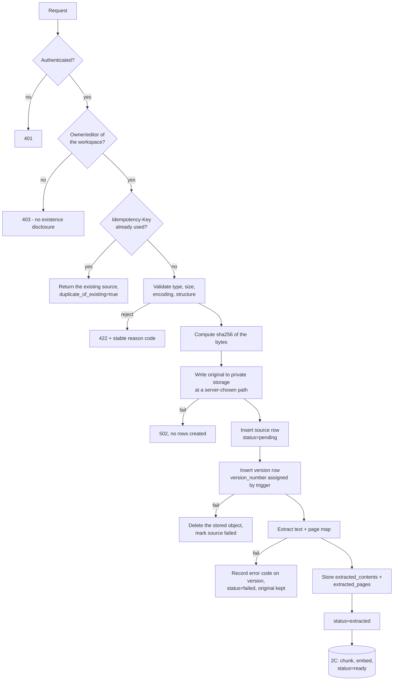

# Ingestion Pipeline

How a file or a note becomes a versioned, citable source. Implemented in
Phase 2B; phases 2C (chunking/embedding) extend it at step 9.

## Contract

`IngestionPipeline` (`backend/app/services/ingestion/pipeline.py`) is the only
code path that creates sources and versions. No route, agent or script writes
those tables directly.

## Step order



Each arrow that can fail has a defined end state; there is no path that leaves
a row pointing at a missing object or an object referenced by no row.

## Authorization

`IngestionPipeline._require_contributor` calls `WorkspaceService.get_workspace`,
which checks membership and raises `ForbiddenError` for a stranger. RLS is the
second layer: even if the service check were removed, the insert policy requires
`owner_id = auth.uid()` **and** `can_contribute_to_workspace(workspace_id)`.

Order matters: authorization runs **before** the bytes are stored, so an
unauthorized caller cannot use the endpoint to fill the bucket.

## Validation (trust nothing)

`backend/app/services/ingestion/validation.py`:

| Check | Rule | Failure code |
|---|---|---|
| Size | 1 byte … 50 MiB (matches the bucket limit) | `empty_file`, `file_too_large` |
| Declared type | must be in the allow-list | `unsupported_type` |
| Actual type | detected from magic bytes / decoding, not from the declaration | `type_mismatch` |
| Office/ZIP containers | recognised and refused explicitly | `unsupported_type` |
| Text encoding | UTF-8 (with or without BOM) or UTF-16 with a BOM | `unsupported_encoding` |
| Binary content | NUL byte in the first 4 KiB → binary | `binary_content` |
| Filename | path components stripped, control chars replaced, 120-char stem cap | — |
| Storage path | `<auth.uid()>/<server-uuid><ext>`; never client-supplied | — |
| Title | explicit, else filename stem, ≤ 300 chars | `missing_title` |
| Note length | 1 … 200 000 characters | `empty_file`, `file_too_large` |

A client that uploads a text file named `.pdf` gets `type_mismatch`; it cannot
use the extension to choose the parser.

## Extraction

| Format | Method | Location produced |
|---|---|---|
| Plain text | `plain-text` | one segment, offsets `[0, len)` |
| Markdown | `markdown` | segments split at headings; heading offsets in `metadata` |
| PDF | `pdf` | one segment **per page**, offsets into the concatenated text |

`pypdf` is used for PDFs. It is a pure-Python reader: it does not execute
JavaScript, render pages, or write files.

Explicit failure codes, all recorded on the version and surfaced to the user:

| Code | Meaning | User guidance |
|---|---|---|
| `no_text_layer` | PDF contains no extractable text | likely a scan; OCR is not implemented |
| `encrypted_pdf` | password-protected | remove the password and re-upload |
| `corrupt_pdf` | unparseable | file is damaged |
| `unsupported_encoding` | not UTF-8/UTF-16 | re-save as UTF-8 |
| `too_much_text` | > 2 000 000 characters | the document is too large to index |

A failed extraction **keeps the original** and records the reason. It never
reports `ready`, and the UI says "Stored, but text extraction failed" rather
than implying success.

## Idempotency

- The route accepts an `Idempotency-Key` header (or body field for notes).
- `sources (workspace_id, idempotency_key)` is unique where non-null.
- A repeat returns the **existing** source with `duplicate_of_existing: true`;
  no second object is stored and no second version is created.
- The frontend generates `ingest-<uuid>` per submission, so a network retry of
  the same form submission cannot duplicate a document.

Retrying a *failed* ingestion is an explicit user action, not an automatic
retry: automatic retries against a deterministic parser would only repeat the
same failure.

## Versioning

- A new submission for an existing source retires the previous version
  (`is_current = false`) and inserts a new row. The previous row, its extracted
  text and its chunks remain, which is what makes historical questions
  answerable later (Phase 4A).
- `version_number` is assigned by a trigger; the unique constraint is the
  authoritative guard for concurrent inserts.
- The old version's storage object is **kept**, because old chunks still cite
  it.

## Deletion

`DELETE /api/v1/knowledge/sources/{id}`:

1. the caller must be the source owner (service check) and a contributor (RLS);
2. every storage object for the source and its versions is removed first;
3. the source row is deleted; `ON DELETE CASCADE` removes versions, extracted
   text, pages, chunks and provenance records.

Removing objects before rows means a storage failure leaves the database
untouched, so the operation can be retried instead of leaving rows that point
at nothing.

## Storage layout

```
sources/                      (private bucket)
  <auth.uid()>/
    <server-uuid>.pdf         original submitted in this version
    <server-uuid>.md
    <server-uuid>.txt         notes are stored the same way
```

The bucket policy requires `(storage.foldername(name))[1] = auth.uid()::text`,
so another user's path cannot be written even with a forged request. Objects
are immutable: there is no UPDATE policy.

## What is *not* implemented

- OCR for scanned PDFs, and Office/ODT parsing (the bucket allow-list includes
  them, but the extractor registry does not — uploads of those types are
  refused with a clear message rather than failing later).
- Automatic retry/backoff for failed extraction.
- Virus scanning. Documents are never executed and are parsed by `pypdf` only,
  but no antivirus is run.
- Streaming uploads: files are read into memory (bounded at 50 MiB) before
  validation.
- **Remote Supabase storage has not been exercised** — no project credentials
  are available in this environment. The storage adapter is covered by unit
  tests with a fake; the real `storage3` call path is unverified.

## Testing

| Layer | Where | What it proves |
|---|---|---|
| Validation | `tests/unit/test_ingestion_validation.py` (38) | every rejection path, filename safety, MIME spoofing |
| Extraction | `tests/unit/test_ingestion_extraction.py` (19) | offsets, page maps, encrypted/corrupt/no-text PDFs |
| Pipeline | `tests/unit/test_ingestion_pipeline.py` (20) | ordering, statuses, cleanup, idempotency, versions, deletion |
| Database | `tests/integration/test_knowledge_schema_live.py` (3) | real constraints, cascade, excerpt reconstruction |
| UI | `src/features/knowledge/KnowledgePage.test.tsx` (9) | empty state, real status rendering, upload result, rejection, notes |
