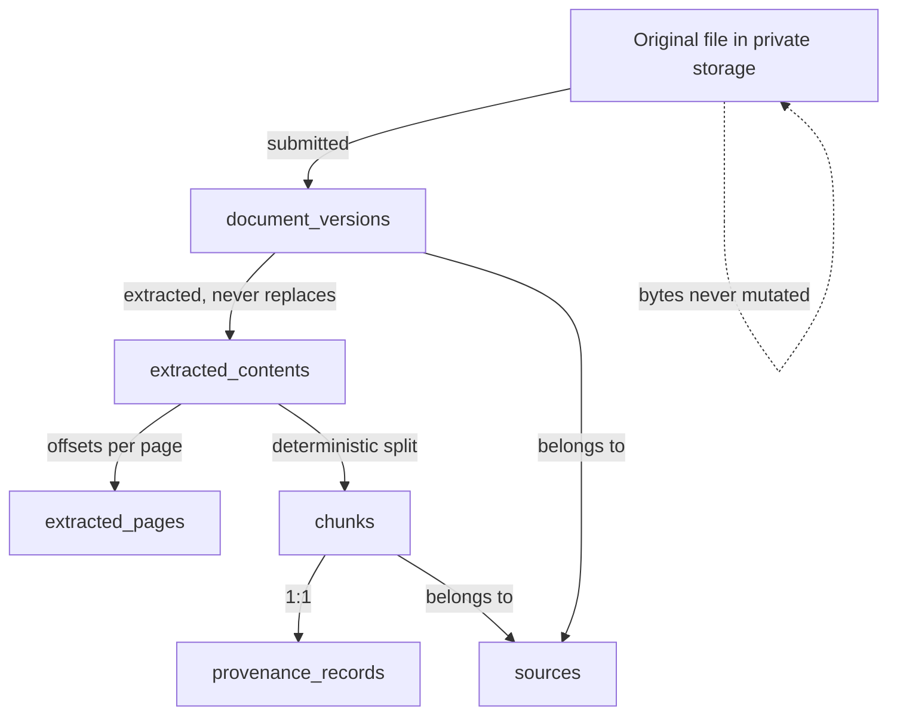

# Provenance Model

MNEMOS exists to answer questions **and** show exactly where every statement
came from. This document defines the provenance model implemented in Phase 2A
and the invariants every later phase must preserve.

## 1. The problem

A retrieval-augmented system that stores text and returns citations can still
lie in two ways:

1. **Fabricated citation** — the model invents a source, a page, or a quote.
2. **Detached provenance** — the text exists but the link to the exact version
   and location has been lost, so the "citation" points at a whole document,
   or at a version that was replaced.

Both are structural problems, not prompting problems. The model below removes
the possibility by construction: a passage cannot exist without a chunk, a
chunk cannot exist without a version, and a citation cannot be written without
agreeing with the chunk it points at.

## 2. The six entities

| Entity | Meaning | Mutable? |
|---|---|---|
| **Source** | the item the user submitted (a document or a note) | metadata only (`title`, `processing_status`) |
| **Document version** | one immutable submission of a source | content fields frozen by trigger |
| **Extracted content** | text derived from one version | replaced only by re-extraction, with a recorded method |
| **Chunk** | a deterministic slice of a version's extracted text | never edited; re-chunking creates a new set |
| **Provenance record** | the durable citation identity of a chunk | `information_status` and revision links only |
| **Evidence** (3A) | a retrieved chunk presented to the model | constructed per query, never stored as truth |

The original bytes are **never** overwritten. Extraction produces a *copy* of
the text; chunking produces *slices* of that copy. If extraction changes, the
original is still intact and the new extraction can be compared against it.

## 3. The reusable provenance contract

Resolved with one call (`public.resolve_chunk_provenance(chunk_id)`,
`GET /api/v1/knowledge/chunks/{chunk_id}/provenance`) and represented in Python
as `app.domain.knowledge.ProvenanceReference`:

| Field | Source | Why it exists |
|---|---|---|
| `provenance_id` | `provenance_records.id` | stable identity of this passage across re-indexing |
| `chunk_id` | `chunks.id` | the exact text unit that was retrieved |
| `source_id` | `sources.id` | the user-facing document identity |
| `document_version_id` | `document_versions.id` | *which submission* the text came from |
| `workspace_id` | all three rows agree | scope; a citation never crosses stores |
| `source_title` | `sources.title` | display only — never the identity |
| `source_kind` | `sources.kind` | `document` or `note` |
| `version_number` | `document_versions.version_number` | "version 2 of this note" |
| `source_location` | `chunks.source_location`, cross-checked | `{start_offset, end_offset, page?}` |
| `chunk_index` | `chunks.chunk_index` | ordering within the version |
| `information_status` | `provenance_records.information_status` | current / superseded / disputed / archived / pending_review |
| `revision_reference` | `provenance_records.revision_of` | what this passage revises (4A) |
| `superseded_by` | `provenance_records.superseded_by` | what replaced it (4A) |
| `document_created_at` | `document_versions.created_at` | when this submission was recorded |
| `submitted_at` | `document_versions.submitted_at` | when the user submitted it |
| `resolution_metadata` | `provenance_records.resolution_metadata` | how the location was computed |

The separation matters: **display text is not identity**. `source_title` can be
renamed; `source_id` cannot. A UI that shows a title without a resolvable
`source_id` + `document_version_id` is showing decoration, not provenance.

## 4. Location strategy

There is no single "page number" concept that works for a note, a Markdown
file and a PDF, so location is a JSONB object with a **required core** and
optional refinements:

| Source kind | `start_offset` / `end_offset` | `page` | `section` |
|---|---|---|---|
| Plain text | character offsets into extracted text | absent | optional heading path |
| Markdown | character offsets | absent | optional heading path |
| PDF | character offsets | **present** (1-based) | absent |
| Note | character offsets | absent | absent |

`extracted_pages` records each page's `[start_offset, end_offset)` so a chunk
can be mapped to a page without re-parsing the PDF. When a parser cannot
determine a page (scanned PDF with no text layer, for example), the page field
is absent and the system must say "location unavailable" instead of guessing.

**Honest unavailability.** `ProvenanceReference.has_location()` returns False
when neither a page nor offsets are known. Phase 3 will render such evidence
as "location unavailable" and cannot claim page-level support for it. This is
enforced by `chunks_location_offsets_present`, so a chunk can never be stored
without offsets; only the page refinement can be absent.

## 5. Invariants (and where they are enforced)

| # | Invariant | Enforced by |
|---|---|---|
| P1 | A version belongs to exactly one source | FK `source_id` |
| P2 | A version cannot move between sources or workspaces | `protect_document_version_content` trigger |
| P3 | At most one current version per source | partial unique index |
| P4 | Old versions are retained, with their chunks | no delete on version replacement; verified |
| P5 | A chunk's source must equal its version's source | `validate_chunk_relationships` trigger |
| P6 | A chunk cannot exist in a different workspace from its version | composite FK on `(document_version_id, workspace_id)` |
| P7 | A chunk always has offsets | `chunks_location_offsets_present` + validity check |
| P8 | A provenance record's source/version/location match its chunk | `validate_provenance_relationships` trigger |
| P9 | A provenance record's `submitted_at` equals the version's | same trigger |
| P10 | Provenance survives until its chunk is deleted; chunks are not deleted casually | cascade only; 4A adds a usage guard |
| P11 | Users cannot write chunks or provenance | RLS: SELECT-only grants; verified by test |
| P12 | A citation cannot resolve across workspaces | `SECURITY INVOKER` resolution + RLS on join tables |

## 6. What this does *not* claim

- Formatting of a quote is not verified here; 3C compares extracted claim text
  against stored passages.
- Page numbers are as reported by the parser, not ground-truth pagination of a
  printed edition.
- Provenance proves *where text came from*, not that the text is true.
  Correctness is a separate dimension (3C).
