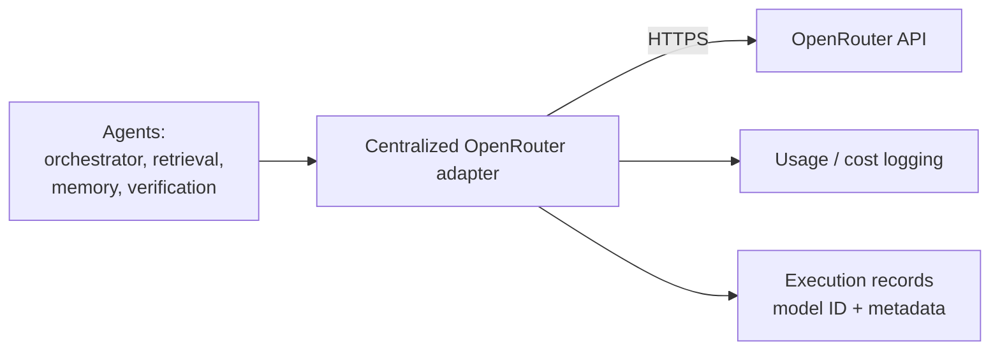

# OpenRouter Foundation

OpenRouter is MNEMOS's model-access and routing layer. It is **not** a
language model. Phase 0 prepares the integration boundary and
configuration only — **no adapter code, no model calls, no paid
endpoints.**

## Architecture (planned)

## Configuration

All model identifiers come from environment variables — never hardcoded:

| Variable | Purpose |
|---|---|
| `OPENROUTER_API_KEY` | API key (server-side only) |
| `OPENROUTER_DEFAULT_MODEL` | Fallback model ID |
| `OPENROUTER_ORCHESTRATOR_MODEL` | Orchestrator responsibility |
| `OPENROUTER_RETRIEVAL_MODEL` | Retrieval responsibility |
| `OPENROUTER_MEMORY_MODEL` | Memory responsibility |
| `OPENROUTER_VERIFICATION_MODEL` | Verification responsibility |
| `OPENROUTER_TIMEOUT_SECONDS` | Request timeout (default 30) |
| `OPENROUTER_MAX_RETRIES` | Bounded retries (default 3) |

See `.env.example` for placeholders. Get a key at
https://openrouter.ai/keys.

## Adapter requirements (future implementation)

- Centralized client; no scattered model HTTP calls.
- Request/response normalization and structured-output validation.
- Tool-calling capability checks per model before use.
- Timeouts, bounded retries with backoff, error classification,
  rate-limit handling.
- Usage and cost logging where available; model ID in every execution
  record.
- Tests use recorded fixtures/mocks — never live paid calls in CI.

## Phase 0 status

- [x] Integration approach decided (ADR-0004)
- [x] Configuration strategy documented
- [ ] Adapter implemented (later phase)
- [ ] Model IDs selected and validated per responsibility (later phase)
